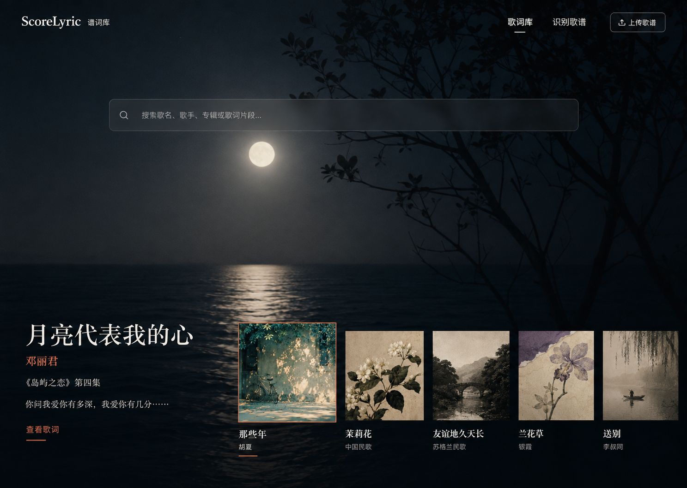

# ScoreLyric 谱词库

ScoreLyric 是一款面向 NAS 用户的本地歌谱歌词识别与管理工具。用户可在局域网中上传图片或 PDF 歌谱，完成 OCR、歌词校对、段落整理、多版本保存和全文检索。歌谱原图、歌词和识别结果默认保存在用户自己的 NAS 上。

## 开发状态

当前处于“产品原型与本地化架构转型”阶段。

已完成：

- 响应式首页、歌词库、歌词详情页和歌谱识别工作台
- 首屏精选歌词与精选专辑自动轮播
- 精选列表由服务端配置传入，可迁移到未来的后台设置
- 歌手、专辑、语言、年代、曲风和歌谱来源浏览入口
- 最近更新无限瀑布流布局
- 歌名、歌手、专辑和歌词片段搜索交互
- 中文、英文、中英双语与精简/完整段落展示原型

尚未完成：

- Docker / Docker Compose 封装
- 真实文件上传、本地 OCR 和歌词校对流程
- SQLite 持久化、用户权限、备份和恢复
- NAS 后台管理页及精选专辑持久化设置
- `amd64` / `arm64` 多架构镜像验证

## 产品定位

- 以 Docker 方式安装到群晖、威联通、Unraid 或通用 Linux NAS
- 通过 `http://NAS-IP:端口` 在局域网内访问
- 核心识别、管理、搜索和校对能力可离线运行
- OCR 模型随镜像或本地数据卷提供，不上传用户原图
- 翻译为可选能力：可使用本地模型，或由用户自行配置外部 API
- 不以公开网站、公开注册和公共歌词发布为主要产品目标

## 预期本地架构

```text
局域网浏览器
        ↓
ScoreLyric Web + Local API
        ↓
SQLite + 本地文件目录
        ↓
本地 OCR Worker
```

初期优先使用单机简化架构：

- Web：Next.js、React、TypeScript
- API / OCR：Python、FastAPI、PaddleOCR CPU
- 数据：SQLite，后续按需增加全文索引
- 文件：NAS 持久化数据卷
- 部署：Docker Compose

## 首页设计演进

### 第一版：温暖留白的横向档案馆

以浅色纸张、唱片和横向专辑陈列建立“私人歌词档案馆”的感觉。


### 第二版：沉浸式歌词影院

使用全屏专辑背景、歌词摘录和精选专辑建立沉浸式首页，完成搜索、专辑切换和歌词跳转。



### 第三版：首屏精选 + 本地歌词库（当前版本）

首页严格占满第一屏，展示后台选定的精选歌词和精选专辑。精选专辑自动轮播，切换时同步更新背景、歌词和选中状态。向下滚动进入独立白色歌词库，可按歌手、专辑、语言、年代、曲风和歌谱来源浏览，最后以无限瀑布流展示最近更新。


## 产品原则

1. 用户数据默认保存在 NAS 本地。
2. 核心功能运行时不依赖外部接口。
3. 优先适配 CPU 和有限内存，不把 GPU 作为安装前提。
4. 数据库、上传目录和模型目录必须通过 Docker volume 持久化。
5. 外部翻译、元数据查询和更新检查必须可关闭。
6. 升级前可备份，升级后可迁移和恢复。

## 开发路线

### M0：响应式产品原型（已完成）

- 首页、歌词库、详情页和识别工作台
- 精选专辑轮播与响应式布局
- 浏览器视觉 QA、ESLint 和生产构建

### M1：NAS 本地数据闭环

- SQLite 歌曲、歌手、专辑、歌词版本和设置模型
- 真实搜索、新增、编辑和删除
- 后台精选专辑设置
- 数据目录、备份与恢复

### M2：本地上传与 OCR

- JPG、PNG、WebP 和 PDF 文件校验
- PaddleOCR CPU 本地识别
- 任务队列、进度、失败重试和结果缓存
- 主歌、副歌、反复记号和段落结构初步解析

### M3：校对、翻译与多版本

- 可视化校对与版本历史
- 中文、英文和双语版本
- 精简段落与完整演唱顺序
- 可选本地翻译或用户配置的外部 API

### M4：Docker 与 NAS 发布

- Docker Compose 一键启动
- `amd64` / `arm64` 多架构镜像
- 群晖、威联通和 Unraid 安装说明
- 健康检查、日志、升级、备份和迁移验证

## 本地前端开发

当前原型需要 Node.js 22.13 或更高版本。

```bash
npm ci
npm run dev
```

验证：

```bash
npm run build
npm test
npm run lint
```

## 安全边界

- `.env`、API Key、密码和 NAS 凭据不提交到仓库
- 容器默认仅提供局域网访问，不默认暴露到公网
- 用户原图、草稿和识别结果必须执行服务端权限校验
- 删除、批量替换、数据库迁移和恢复操作需要明确确认

## 更新记录

### 2026-08-23 · Design V3 / NAS 方向

- 项目定位由公开网站调整为 NAS 本地 Docker 应用
- 首页调整为完整第一屏，歌词库从第二屏开始
- 新增精选专辑自动轮播、手动切换、暂停和过渡动画
- 新增歌手、全部专辑、语言、年代、曲风、来源和收藏栏目
- 新增最近更新响应式瀑布流
- 完成 1280px 桌面端和 390px 移动端视觉验收

### 2026-08-23 · Design V2

- 完成沉浸式全屏歌词首页
- 实现搜索、专辑切换、详情跳转和移动端布局

### 2026-08-23 · Design V1 / Prototype

- 创建 ScoreLyric 基础项目
- 建立浅色歌词档案馆首页、歌词详情页和识别工作台
